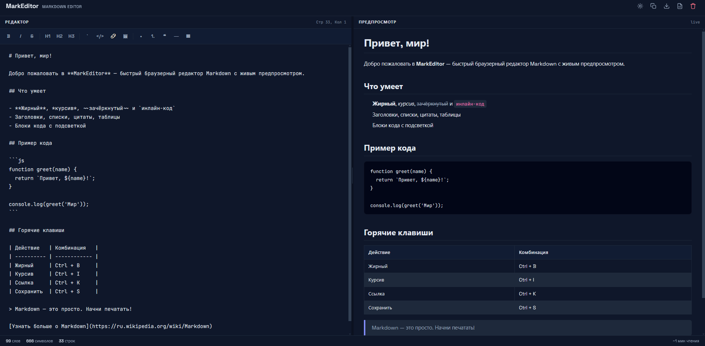

<div align="center">

# MarkEditor

<p>
   
</p>

**A fast, browser-based Markdown editor with live preview.**

[](https://developer.mozilla.org/en-US/docs/Web/HTML)
[](https://developer.mozilla.org/en-US/docs/Web/CSS)
[](https://developer.mozilla.org/en-US/docs/Web/JavaScript)
[](https://tailwindcss.com/)
[](https://opensource.org/licenses/MIT)

</div>

---

## ✨ Features

MarkEditor is a lightweight, zero-setup Markdown editor that runs entirely in your browser.

| Feature | Description |
| :--- | :--- |
| **Live Preview** | See your rendered Markdown instantly as you type. |
| **Toolbar** | One-click formatting for bold, italic, headings, links, code, lists, and more. |
| **Keyboard Shortcuts** | Boost productivity with `Ctrl+B`, `Ctrl+I`, `Ctrl+K`, and `Ctrl+S`. |
| **Dark / Light Theme** | Toggle between themes. Your choice is saved in `localStorage`. |
| **Resizable Panes** | Drag the divider to adjust the editor/preview split. |
| **Statistics** | Real-time word, character, line count, and estimated reading time. |
| **Export Options** | Copy Markdown to clipboard, download as `.md`, or export as a styled `.html` file. |
| **Mobile-Friendly** | Responsive design with dedicated tabs for editor and preview on small screens. |
| **Autosave** | Your draft is saved to `localStorage` automatically. Restored on next visit. |

---

## 🚀 Quick Start

No build tools, no dependencies to install. Just open the file.

1. **Clone the repository:**
   ```bash
   git clone https://github.com/OkamiCoder/markeditor.git
   ```

2. **Navigate to the project folder:**
   ```bash
   cd markeditor
   ```

3. **Open `index.html` in your browser.**

That's it! The editor is ready to use.

---

## 🛠️ Tech Stack

- **HTML5** - Semantic structure.
- **CSS3** - Custom properties (variables) for theming, Flexbox & Grid for layout.
- **JavaScript (ES6+)** - All logic, rendering, and local storage.
- **Tailwind CSS** - Utility-first styling via CDN (no build step).
- **Marked.js** - Markdown parsing.
- **DOMPurify** - HTML sanitization for safe preview.

---

## 📁 Project Structure

```text
markeditor/
├── index.html      # Main HTML document
├── style.css       # All custom styles & theme variables
└── script.js       # Editor logic, rendering, and interactions
```

---

## 🌐 Live Demo

You can try MarkEditor right now on **GitHub Pages**:

[**https://okamicoder.github.io/markeditor/**](https://okamicoder.github.io/markeditor/)

---

## 📄 License

Distributed under the MIT License. See `LICENSE` for more information.

---

<p align="center">
  Built with ❤️ by <a href="https://github.com/OkamiCoder">OkamiCoder</a>
</p>
